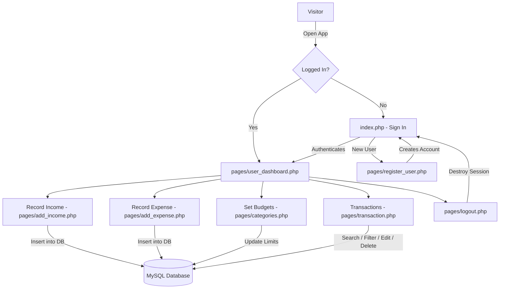
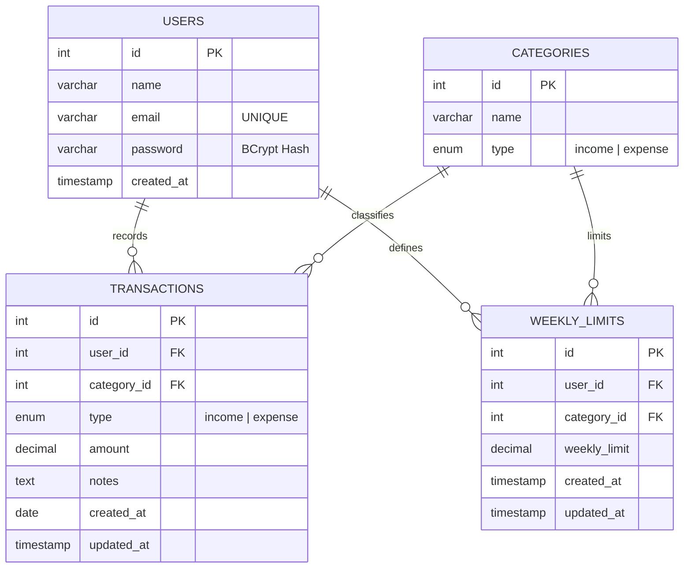

# 💰 Expense Tracker - Personal Finance & Budget Management System

A modern, secure, and responsive web application built with **PHP 8+**, **MySQL**, **Bootstrap 5**, and **Chart.js**. It empowers users to monitor their daily expenses, track income sources, set category-specific weekly budget limits, and visualize their financial trends through interactive charts.

---

## 📋 Table of Contents

- [Key Features](#-key-features)
- [How the System Works](#-how-the-system-works)
- [System Architecture & Folder Structure](#-system-architecture--folder-structure)
- [Database Design & Optimization](#-database-design--optimization)
- [Installation & Setup Guide](#-installation--setup-guide)
- [Global Design System & Theming](#-global-design-system--theming)
- [Security Implementations](#-security-implementations)
- [Troubleshooting & FAQs](#-troubleshooting--faqs)

---

## ✨ Key Features

1. **User Authentication & Session Security**
   - Secure account registration with input validation and BCRYPT password hashing.
   - Unique email enforcement for account identification (allows multiple users with identical names).
   - Session-based authentication protecting all private dashboard pages.
   - Clean, graceful logout and automatic redirect for already-logged-in users.

2. **Interactive Dashboard & Visual Analytics**
   - **Weekly Summary Cards**: Real-time weekly calculations for **Total Income**, **Total Expense**, and **Net Balance**.
   - **Cashflow Trend Chart**: Interactive Chart.js line graph displaying 7-day and 30-day income vs. expense patterns.
   - **Donut Breakdowns**: Visual percentage distribution of expenses and income by category.

3. **Income & Expense Tracking**
   - Record earnings and expenditures with custom dates, amounts, categories, and optional notes.
   - Date validation preventing future accidental dates.

4. **Category-Specific Weekly Budget Limits**
   - Set weekly spending thresholds on individual expense categories (e.g., Rent, Groceries, Transportation).
   - Real-time progress bars alerting users as they approach or exceed budget limits (Normal `< 75%`, Warning `75% - 99%`, Danger `≥ 100%`).

5. **Transaction Management & Search**
   - Comprehensive history table with category badges, formatted currency (`Rs.`), and dates.
   - Instant search by category name or notes.
   - Filter transactions by type (`Income Only`, `Expense Only`, or `All`).
   - Secure deletion with confirmation modal dialogs.
   - Dynamic routing to dedicated income or expense update forms.

6. **Unified & Responsive UI**
   - Consistent layout with fixed sidebar on desktop and slide-out drawer with backdrop on mobile devices.
   - Standardized `:root` color palette and modern typography (**Inter** font).

---

## 🔄 How the System Works



### Operational Workflow:
1. **User Registers / Logs in**: Validates credentials against hashed passwords in the `users` table. Upon success, stores `user_id`, `name`, and `email` in `$_SESSION`.
2. **Dashboard Overview**: Automatically queries this week's records using `YEARWEEK(created_at, 1)` to summarize cashflow.
3. **Budget Monitoring**: When viewing or adding expenses, the application compares total money spent this week against the threshold stored in `weekly_limits`.
4. **Transactions Ledger**: Performs optimized `LEFT JOIN` queries between `transactions` and `categories` to display history without N+1 query bottlenecks.

---

## 🗂 System Architecture & Folder Structure

```
Expanse_Tracker/
├── admin/                     # Administrative tools
│   ├── delete_user.php        # Safely remove user records
│   └── display_reg_user.php   # View registered user list
│
├── assets/                    # Static styling and frontend scripts
│   ├── app.js                 # Global UI interactions (auto-dismiss alerts, ripple effects)
│   ├── global.css             # App-wide :root design system, colors, cards, and buttons
│   ├── index.css              # Authentication pages styling
│   ├── styles.css             # Sidebar navigation, mobile topbar, and layout offsets
│   ├── categories.css         # Category badge helper classes
│   ├── income_expense.css     # Form progress bar overrides
│   └── user_dashboard.css     # Dashboard icon overrides
│
├── database/                  # Database scripts
│   └── schema.sql             # Complete optimized schema with indexes and seed data
│
├── images/                    # Project image assets & avatars
│   └── user_image/            # User profile pictures
│
├── includes/                  # Reusable server-side components
│   ├── db_conn.php            # MySQL connection with utf8mb4 encoding
│   ├── footer.php             # Bootstrap JS bundle & closing body/html
│   ├── function.php           # Helper functions (alerts, auth checking)
│   └── header.php             # HTML head, typography, topbar, and sidebar
│
├── pages/                     # Core application pages
│   ├── add_expense.php        # Record new expenditure with budget progress
│   ├── add_income.php         # Record new income stream
│   ├── categories.php         # Category management and weekly limit configuration
│   ├── delete.php             # Secure transaction deletion handler (IDOR protected)
│   ├── edit_expense.php       # Update existing expense transaction
│   ├── edit_income.php        # Update existing income transaction
│   ├── logout.php             # Session destruction and cleanup
│   ├── register_user.php      # User registration form
│   ├── transaction.php        # Filterable transaction ledger
│   └── user_dashboard.php     # Main analytics dashboard
│
├── index.php                  # Application entry point / Login page
└── README.md                  # System documentation
```

---

## 🗄 Database Design & Optimization

The database is built on **MySQL (InnoDB)** and optimized for speed, data integrity, and international character support (`utf8mb4`).

### Entity-Relationship Diagram



### Applied Database Optimizations:
1. **Character Set**: Entire database converted to `utf8mb4` with `utf8mb4_unicode_ci` to support symbols and multicharacter names.
2. **Composite Query Indexes**:
   - `idx_tx_user_date (user_id, created_at DESC)`: Speeds up ledger queries and date ordering.
   - `idx_tx_user_type_date (user_id, type, created_at DESC)`: Optimizes weekly sums and line chart aggregation.
   - `idx_tx_user_cat (user_id, category_id)`: Accelerates category-based calculations.
3. **Enforced Unique Constraint**:
   - `weekly_limits(user_id, category_id)`: Enforces that a user has only one limit per category, preventing duplicate limit rows.
4. **Foreign Key Cascades**:
   - Deleting a user automatically cascades and safely removes their related transactions and limits, eliminating orphaned records.

---

## 🚀 Installation & Setup Guide

### Prerequisites
- **XAMPP**, **WampServer**, or **LAMP** stack with:
  - PHP 8.0 or higher
  - MySQL / MariaDB 10.4 or higher
  - Apache Web Server

### Step-by-Step Setup:

1. **Clone or Move the Repository**:
   Copy the project into your local web server's root folder:
   ```bash
   # For Windows (XAMPP default):
   C:\xampp\htdocs\Expanse_Tracker
   ```

2. **Start Services**:
   Open **XAMPP Control Panel** and start **Apache** and **MySQL**.

3. **Import Database Schema**:
   - Open your browser and go to `http://localhost/phpmyadmin/`.
   - Click on the **Import** tab.
   - Select the file located at [`database/schema.sql`](file:///c:/xampp/htdocs/Expanse_Tracker/database/schema.sql).
   - Click **Go** to create the `expense_tracker` database, tables, indexes, and seed categories.

   *Alternatively, import via command prompt:*
   ```bash
   mysql -u root -p < "C:\xampp\htdocs\Expanse_Tracker\database\schema.sql"
   ```

4. **Verify Database Configuration**:
   Ensure [`includes/db_conn.php`](file:///c:/xampp/htdocs/Expanse_Tracker/includes/db_conn.php) matches your local credentials:
   ```php
   $servername = "localhost:3306";
   $username   = "root";
   $password   = "";  // Leave blank for standard XAMPP setup
   $db_name    = "expense_tracker";
   ```

5. **Launch the Application**:
   Navigate to:
   ```
   http://localhost/Expanse_Tracker/
   ```

---

## 🎨 Global Design System & Theming

All theme colors, fonts, and component styles are centralized in [`assets/global.css`](file:///c:/xampp/htdocs/Expanse_Tracker/assets/global.css) using CSS `:root` variables:

| Variable | Hex Value | Usage |
| :--- | :--- | :--- |
| `--primary` | `#4f46e5` | Primary buttons, active sidebar link, brand highlights |
| `--primary-hover` | `#4338ca` | Button hover states |
| `--income` | `#10b981` | Total income, positive balances, income category tags |
| `--expense` | `#ef4444` | Total expenses, delete buttons, warning metrics |
| `--bg-main` | `#f8fafc` | Clean application background (Slate 50) |
| `--bg-card` | `#ffffff` | Card and modal surfaces |
| `--text-dark` | `#0f172a` | High-contrast headings and body text |
| `--text-muted` | `#64748b` | Secondary subtitles and date text |
| `--border-color` | `#e2e8f0` | Dividers and table borders |

> [!TIP]
> To customize the entire color theme, simply modify the `:root` variables in [`assets/global.css`](file:///c:/xampp/htdocs/Expanse_Tracker/assets/global.css). All pages will adapt automatically.

---

## 🔒 Security Implementations

* **Prepared Statements (`mysqli_prepare`)**: All database operations across authentication, transactions, and categories strictly use parameterized prepared statements to eliminate SQL Injection risks.
* **IDOR (Insecure Direct Object Reference) Prevention**:
  * Deleting or updating a transaction checks both the record `id` AND the current `user_id` from the session:
    ```sql
    DELETE FROM transactions WHERE id = ? AND user_id = ?
    ```
* **Password Hashing**: Uses PHP's `password_hash($password, PASSWORD_BCRYPT)` and verifies with `password_verify()`.
* **Session Guarding**: Any unauthenticated attempt to access pages in `/pages/` redirects directly to `index.php` with immediate script termination (`exit()`).
* **Input Sanitization**: User inputs are trimmed and formatted before database processing, with HTML output escaped via `htmlspecialchars()` to prevent Cross-Site Scripting (XSS).

---

## ❓ Troubleshooting & FAQs

#### Q1: "An account with this email address already exists"
- **Cause**: User accounts are uniquely identified by their email address.
- **Behavior**: If someone tries to register with an email that is already registered, the form alerts them. Multiple users are free to register with identical personal/display names.

#### Q2: Sidebar layout looks misaligned or duplicated
- **Solution**: Ensure pages do not manually open `<html>`, `<head>`, or `<body>` tags. Only [`includes/header.php`](file:///c:/xampp/htdocs/Expanse_Tracker/includes/header.php) and [`includes/footer.php`](file:///c:/xampp/htdocs/Expanse_Tracker/includes/footer.php) manage the document shell.

#### Q3: Database connection error `Connection refused`
- **Solution**: Verify MySQL is running in XAMPP and that the port configured in [`includes/db_conn.php`](file:///c:/xampp/htdocs/Expanse_Tracker/includes/db_conn.php) matches your MySQL port (typically `3306`).
